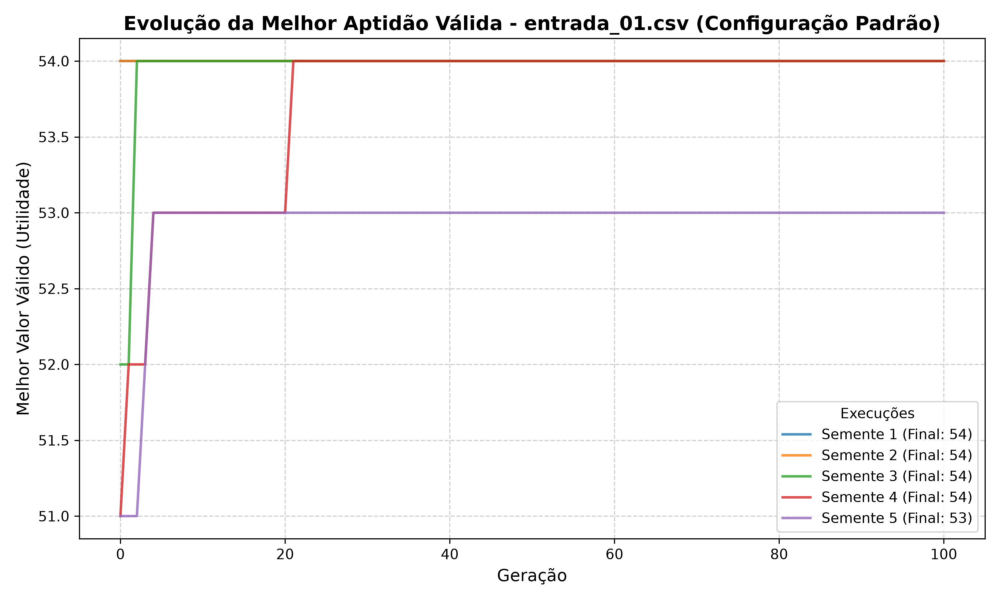
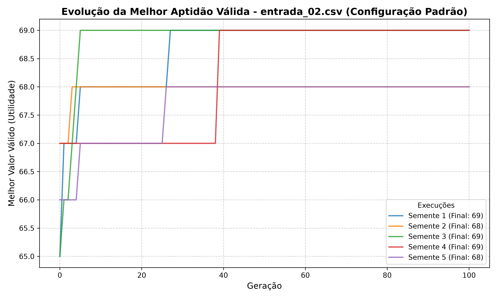
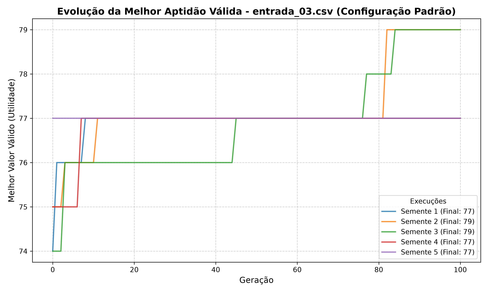
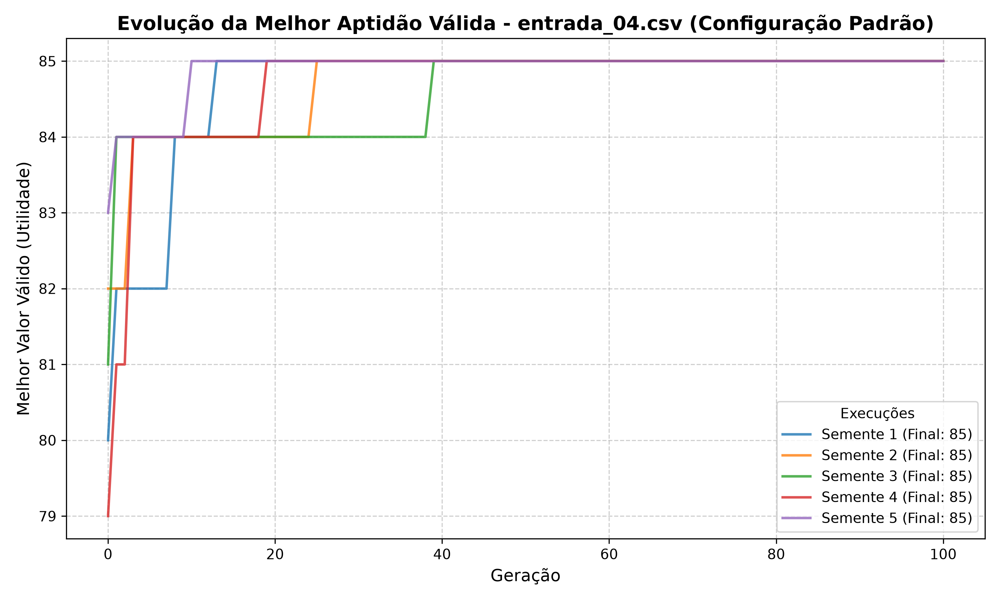
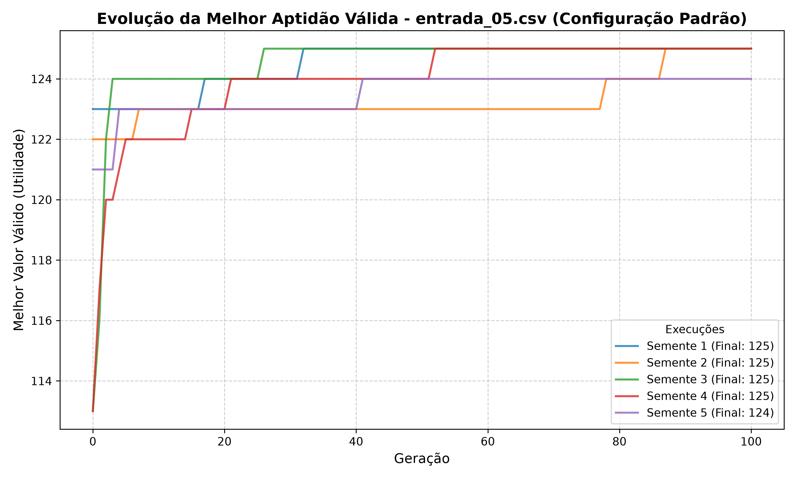
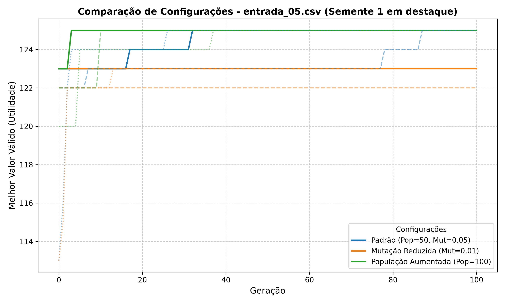

# Atividade: Mochila Binária com Algoritmo Genético

Implementação e análise experimental de um **Algoritmo Genético (AG)** em Python para resolver o problema da **Mochila Binária (0/1 Knapsack Problem)**, aplicado à seleção otimizada de equipamentos sem ultrapassar a capacidade máxima de carga.

---

## 1. Descrição do Problema

Dado um conjunto de $n$ itens, onde cada item $i$ possui um peso $p_i$ (em kg) e um valor de utilidade $v_i$, e uma mochila com capacidade máxima $C$, o objetivo é determinar o vetor binário $x = [x_1, x_2, \dots, x_n]$, com $x_i \in \{0, 1\}$, que:

$$\text{maximiza } V(x) = \sum_{i=1}^{n} v_i x_i \quad \text{sujeito a } \quad P(x) = \sum_{i=1}^{n} p_i x_i \le C$$

### Função de Aptidão (Fitness)
$$f(x) = \begin{cases} V(x), & \text{se } P(x) \le C \\ 0, & \text{se } P(x) > C \end{cases}$$

---

## 2. Estrutura do Projeto

```text
├── Atividade_Mochila_AG.pdf      # Especificação oficial da atividade
├── algoritmo_genetico.py         # Código-fonte principal com CLI configurável
├── executar_experimentos.py      # Script automatizado dos experimentos e gráficos
├── resultados_experimentos.csv   # Tabela com métricas de todas as execuções
├── entradas/                     # Arquivos CSV de entrada com os itens
│   ├── entrada_01.csv            # 10 itens (C = 20 kg)
│   ├── entrada_02.csv            # 12 itens (C = 25 kg)
│   ├── entrada_03.csv            # 14 itens (C = 30 kg)
│   ├── entrada_04.csv            # 16 itens (C = 35 kg)
│   └── entrada_05.csv            # 20 itens (C = 45 kg)
├── graficos/                     # Gráficos de evolução das 5 entradas
│   ├── evolucao_entrada_01.png
│   ├── evolucao_entrada_02.png
│   ├── evolucao_entrada_03.png
│   ├── evolucao_entrada_04.png
│   ├── evolucao_entrada_05.png
│   └── comparativo_entrada_05.png
└── README.md                     # Documentação completa e respostas das questões
```

---

## 3. Como Executar

### Pré-requisitos
- Python 3.10+
- Bibliotecas: `matplotlib` (para gráficos)

### Execução Individual
O script `algoritmo_genetico.py` aceita argumentos por linha de comando sem alterar a lógica interna:
```bash
python algoritmo_genetico.py -a entradas/entrada_01.csv -p 50 -g 100 -c 0.8 -m 0.05 -t 3 -e 1 -s 42
```

**Parâmetros disponíveis:**
- `-a`, `--arquivo`: Caminho do arquivo CSV de entrada (ex: `entradas/entrada_01.csv`).
- `-p`, `--populacao`: Quantidade de indivíduos na população (padrão: `50`).
- `-g`, `--geracoes`: Número de gerações (padrão: `100`).
- `-c`, `--cruzamento`: Taxa de cruzamento de 1 ponto (padrão: `0.8`).
- `-m`, `--mutacao`: Taxa de mutação por gene (padrão: `0.05`).
- `-t`, `--torneio`: Tamanho do torneio de seleção (padrão: `3`).
- `-e`, `--elite`: Número de indivíduos preservados por elitismo (padrão: `1`).
- `-s`, `--semente`: Semente pseudoaleatória para reprodutibilidade.

### Executar Todos os Experimentos e Gerar Gráficos
Para reproduzir todos os experimentos requeridos na atividade e gerar os gráficos:
```bash
python executar_experimentos.py
```

---

## 4. Tabela de Experimentos

Execuções realizadas com as sementes **1, 2, 3, 4 e 5**. Tempo de execução medido estritamente com `time.perf_counter()`, sem incluir I/O ou plotagem.

| Configuração | Entrada | S1 | S2 | S3 | S4 | S5 | Maior Valor | Valor Médio | Tempo Médio (s) |
| :--- | :--- | :---: | :---: | :---: | :---: | :---: | :---: | :---: | :---: |
| **Padrão** (Pop=50, Mut=0.05) | `entrada_01.csv` | 54 | 54 | 54 | 54 | 53 | **54** | 53.8 | ~0.0311 s |
| **Padrão** (Pop=50, Mut=0.05) | `entrada_02.csv` | 69 | 68 | 69 | 69 | 68 | **69** | 68.6 | ~0.0355 s |
| **Padrão** (Pop=50, Mut=0.05) | `entrada_03.csv` | 77 | 79 | 79 | 77 | 77 | **79** | 77.8 | ~0.0340 s |
| **Padrão** (Pop=50, Mut=0.05) | `entrada_04.csv` | 85 | 85 | 85 | 85 | 85 | **85** | 85.0 | ~0.0317 s |
| **Padrão** (Pop=50, Mut=0.05) | `entrada_05.csv` | 125 | 125 | 125 | 125 | 124 | **125** | 124.8 | ~0.0386 s |
| **Mutação Reduzida** (Pop=50, Mut=0.01) | `entrada_05.csv` | 123 | 122 | 123 | 123 | 121 | **123** | 122.4 | ~0.0360 s |
| **População Aumentada** (Pop=100, Mut=0.05) | `entrada_05.csv` | 125 | 125 | 125 | 125 | 125 | **125** | 125.0 | ~0.0705 s |

---

## 5. Melhor Execução de Cada Entrada (Configuração Padrão)

### Entrada 01 (`entrada_01.csv` - Cap: 20 kg)
- **Semente:** 1
- **Vetor binário:** `[0, 0, 1, 0, 0, 1, 0, 1, 0, 0]`
- **Itens selecionados:** `item_03`, `item_06`, `item_08`
- **Peso total:** 20 kg / 20 kg (100% da capacidade utilizada)
- **Valor total (Utilidade):** **54**

### Entrada 02 (`entrada_02.csv` - Cap: 25 kg)
- **Semente:** 1
- **Vetor binário:** `[1, 1, 0, 1, 1, 0, 1, 1, 0, 1, 0, 0]`
- **Itens selecionados:** `item_01`, `item_02`, `item_04`, `item_05`, `item_07`, `item_08`, `item_10`
- **Peso total:** 25 kg / 25 kg (100% da capacidade utilizada)
- **Valor total (Utilidade):** **69**

### Entrada 03 (`entrada_03.csv` - Cap: 30 kg)
- **Semente:** 2
- **Vetor binário:** `[1, 1, 0, 0, 0, 0, 0, 0, 0, 0, 1, 1, 0, 0]`
- **Itens selecionados:** `item_01`, `item_02`, `item_11`, `item_12`
- **Peso total:** 30 kg / 30 kg (100% da capacidade utilizada)
- **Valor total (Utilidade):** **79**

### Entrada 04 (`entrada_04.csv` - Cap: 35 kg)
- **Semente:** 1
- **Vetor binário:** `[0, 1, 1, 1, 0, 0, 0, 0, 0, 1, 0, 1, 0, 1, 0, 0]`
- **Itens selecionados:** `item_02`, `item_03`, `item_04`, `item_10`, `item_12`, `item_14`
- **Peso total:** 35 kg / 35 kg (100% da capacidade utilizada)
- **Valor total (Utilidade):** **85**

### Entrada 05 (`entrada_05.csv` - Cap: 45 kg)
- **Semente:** 1
- **Vetor binário:** `[1, 1, 0, 1, 0, 0, 0, 1, 0, 0, 1, 0, 1, 0, 0, 0, 0, 0, 0, 0]`
- **Itens selecionados:** `item_01`, `item_02`, `item_04`, `item_08`, `item_11`, `item_13`
- **Peso total:** 45 kg / 45 kg (100% da capacidade utilizada)
- **Valor total (Utilidade):** **125**

---

## 6. Gráficos de Evolução da Aptidão

Os gráficos abaixo demonstram a evolução do melhor indivíduo válido ao longo das 100 gerações para cada uma das entradas sob as 5 sementes testadas:

| Entrada 01 | Entrada 02 |
| :---: | :---: |
|  |  |

| Entrada 03 | Entrada 04 |
| :---: | :---: |
|  |  |

| Entrada 05 (Padrão) | Comparativo Entrada 05 |
| :---: | :---: |
|  |  |

---

## 7. Respostas das Questões Teóricas

### 1. Por que execuções diferentes podem produzir resultados diferentes?
O Algoritmo Genético é uma meta-heurística **estocástica** (probabilística). A semente pseudoaleatória determina:
- A composição dos indivíduos gerados na população inicial;
- Quais indivíduos são sorteados para competir em cada torneio de seleção;
- O ponto exato de corte em cada operação de cruzamento;
- Quais genes específicos sofrerão mutação por inversão de bit.

Como o espaço de busca combinatório cresce exponencialmente com o número de itens ($2^n$), sementes diferentes conduzem a trajetórias de busca distintas no espaço de soluções, podendo convergir para ótimos locais diferentes ou requerer números distintos de gerações para atingir a melhor solução.

---

### 2. Como o elitismo afeta a evolução?
O elitismo preserva diretamente a melhor solução válida encontrada na geração atual para a geração seguinte sem modificações. Seus principais impactos são:
- **Monotonicidade do melhor resultado:** Garante que a melhor aptidão alcançada nunca sofra regressão ao longo das gerações.
- **Proteção contra operadores destrutivos:** Impede que combinações de alta aptidão sejam perdidas por cruzamentos desfavoráveis ou mutações deletérias.
- **Aceleração da convergência:** Fornece indivíduos de referência de alta qualidade contínua para servirem como pais nas seleções por torneio subsequentes.

---

### 3. O que mudou ao reduzir a taxa de mutação (de 0,05 para 0,01)?
Na `entrada_05.csv`, ao reduzir a taxa de mutação para 0,01:
- A média dos valores obtidos **caiu de 124.8 para 122.4**, e o maior valor alcançado caiu de **125 para 123**.
- A variabilidade genética da população foi drasticamente reduzida, pois com menos inversões de genes a capacidade de introduzir novos alelos ou escapar de bacias de atração diminuiu.
- O algoritmo sofreu **convergência prematura**, ficando preso em máximos locais subótimos antes de descobrir as melhores combinações de itens.

---

### 4. O que mudou ao aumentar o tamanho da população (de 50 para 100 indivíduos)?
Ainda na `entrada_05.csv`, ao dobrar o tamanho da população:
- **Consistência máxima:** Todas as 5 sementes (100% dos testes) alcançaram o valor máximo de **125** (média perfeita de 125.0, contra 124.8 na população de 50).
- **Maior diversidade genética:** Uma população inicial maior cobre uma fração mais ampla e representativa do hipercubo de busca booleano, acelerando a descoberta de blocos construtores (*building blocks*) promissores.
- **Custo computacional:** O tempo médio de execução aumentou de **0.0386 s** para **0.0705 s** (um aumento proporcional de aproximadamente 82%), refletindo o número dobrado de avaliações de aptidão e seleções por torneio a cada geração.
